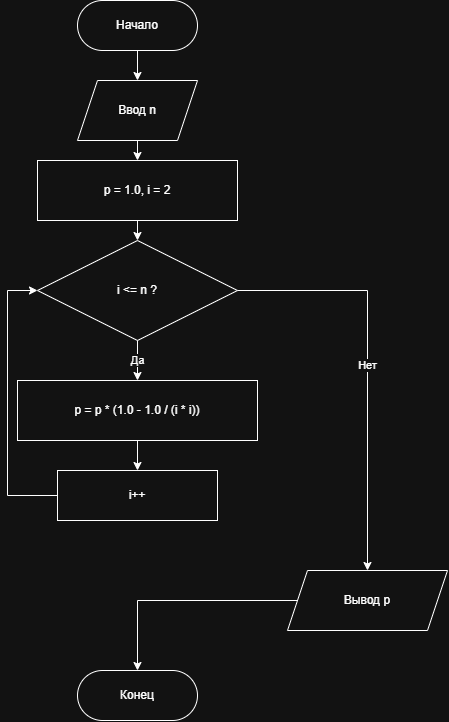

# Домашнее задание к работе 8

## Условие задачи (Вариант 11)

Вычислите с использованием цикла `for` значение для заданного `n`:

$$P = \left(1 - \frac{1}{2^2}\right) \times \left(1 - \frac{1}{3^2}\right) \times \dots \times \left(1 - \frac{1}{n^2}\right)$$

## 1. Алгоритм и блок-схема

### Алгоритм

1. Ввести натуральное число `n`.
2. Присвоить `p = 1.0`.
3. Для `i` от 2 до `n` с шагом 1 выполнять: `p = p * (1.0 - 1.0 / (i * i))`.
4. Вывести значение `p`.
5. Завершить программу.

### Блок-схема

### 


## 2. Реализация программы

```c
#include <stdio.h>

int main() {
    int n;
    double p = 1.0;

    printf("Введите n: ");
    scanf("%d", &n);

    for (int i = 2; i <= n; i++) {
        p *= (1.0 - 1.0 / (i * i));
    }

    printf("Результат: %f\n", p);
    return 0;
}
```

## 3. Тестирование

Проверка по формуле $P = \dfrac{n+1}{2n}$:

- При $n = 3$: $P = \left(1 - \frac{1}{4}\right)\left(1 - \frac{1}{9}\right) = \frac{2}{3} \approx 0.666667$
- При $n = 5$: $P = \frac{6}{10} = 0.600000$

## 4. Разработчик

- **ФИО:** Кочанов Кирилл Романович
- **Группа:** БОТИ-261
